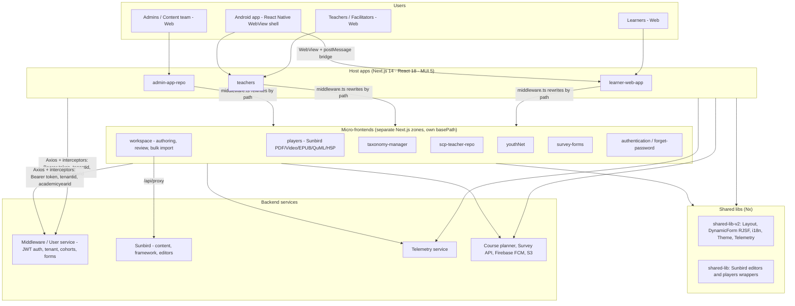

# Pratham 2.0: Frontend content for the tech review slides

Source: the `pratham2.0` repo (branch `release-1.17.0-prod`). This covers the **frontend only**. Backend, data and infra owners should add their own parts.

---

## Slide 8: The architecture and why we chose it

### Architecture diagram (frontend)



Plain-text version for redrawing on the slide:

```
 Learners    Teachers    Admins/Content     Android (RN WebView shell)
    |           |              |                       |
 learner-web  teachers    admin-app-repo   <-- same web apps loaded in WebView
    \___________|______________/
                |   path-based rewrites (Next.js multi-zone)
   +------------+-------------------------------------------+
   | players | workspace | taxonomy | scp-teacher | youthNet |
   | survey-forms | authentication | forget-password         |
   +--------------------------------------------------------+
                |   shared-lib-v2 (DynamicForm, i18n, theme, telemetry)
                v
   Middleware/User svc · Sunbird (content/framework) · Telemetry · S3 · FCM

 Hosting: 3 Docker images (learner / teacher / admin), PM2 runs each zone,
          GitHub Actions -> AWS ECR (ap-south-1), dev / qa / prod pipelines
```

**Layers:** host apps, micro-frontends, shared libs, API layer, backend services
**Components:** 3 host apps, about 8 active MFEs, 2 shared libs
**Integrations:** Middleware/User service, Sunbird, Telemetry, Firebase FCM, GA4, S3, reCAPTCHA
**Hosting:** Docker (node 20) with PM2 multi-zone, AWS ECR, GitHub Actions CI for dev, qa and prod

### Why this architecture (right-hand panel)

**Scale**
- An Nx monorepo with micro-frontends lets teams build, deploy and own each area (learner, teacher, admin, players, workspace) separately, so a change in one zone does not redeploy everything.
- Next.js 14 with SSR and static assets cached as immutable on S3 keeps page loads light as users and content grow.
- Content runs on Sunbird players and a Sunbird-based content backend, so the content library can grow without changes to the frontend.

**Multi-program**
- Each tenant has its own config: every API call carries the `tenantid` and `academicyearid` headers, and `/api/tenantConfig` returns the program's channel and frameworks.
- Forms are driven by the backend: registration and profile forms are RJSF schemas fetched from the `form/read` API, so a new program's fields need no code change.
- Programs get their own routes and modules: `[programName]` routes, POS, Thematic, SCP and YouthNet modules, program switching, per-program GA IDs and frameworks (`frameworkConfig.ts`).
- Role-based route guards and feature flags turn features on per program and role.

**Web, Android and low connectivity**
- One codebase serves both web and Android. The Android app is a React Native WebView shell that loads the same web apps and talks to them through a `postMessage` bridge, which handles login tokens and downloads.
- Learning progress can be tracked offline. A custom service worker queues progress calls in IndexedDB and syncs them with retries when the device is back online. The SCP teacher app is a PWA.
- Players and content are cached client-side with `idb-keyval`, and static assets are cached as immutable to cut repeat downloads.
- The UI is localized in up to 10 Indian languages through i18next, with RTL support and accessibility options (font size, color inversion), to reach rural users.

---

## Slide 9: Key choices and the reasoning (frontend view)

"Alternatives considered" lists the usual options for each area. **The team should confirm which ones were actually evaluated.**

| Area | Decision | Alternatives considered | Reasoning |
|---|---|---|---|
| **Web frontend** | Next.js 14 + React 18 + TypeScript, MUI 5 design system, Nx monorepo split into micro-frontends (Next.js multi-zone; Module Federation where runtime sharing is needed) | Single SPA (CRA/Vite), Angular (Sunbird default), single-spa, a separate repo per app | SSR helps on slow networks. MFEs let teams deploy independently. Nx shares libs (shared-lib-v2) and caches builds. MUI gives accessible components quickly. React has the largest hiring pool. |
| **Android app** | React Native WebView shell that reuses the web apps, with a native bridge (`postMessage`) for tokens and downloads, plus PWA/service worker for offline | Fully native Android, a full React Native rewrite, Capacitor/Cordova, Flutter | One codebase for web and Android, so features ship to both at once. Smaller team cost. The native shell still gives Play Store presence and device features. |
| **Backend & APIs** (frontend integration) | Axios client with interceptors (Bearer JWT, tenant/academic-year headers, auto refresh on 401); React Query for server state, Zustand for client state; Sunbird APIs reached through a Next.js API proxy | GraphQL/BFF, Redux Toolkit, calling Sunbird directly | Interceptors apply multi-tenant headers and auth in one place. React Query handles caching and retries on flaky networks. Zustand needs less boilerplate than Redux. The proxy hides Sunbird endpoints and avoids CORS problems. |
| **Data & storage** (client side) | Backend-driven RJSF forms; Sunbird frameworks/taxonomy for content metadata; IndexedDB (idb-keyval) for offline queues and cache; localStorage for session and tenant context | Hard-coded forms, a custom content schema, PouchDB/SQLite, an offline-first sync engine | New programs and fields are added through config, not code. Sunbird taxonomy is a standard shared across programs. IndexedDB is light and works in the browser and in the WebView. |
| **Hosting & security** | Docker (node 20) with 3 images (learner, teacher, admin); PM2 runs the zones; GitHub Actions to AWS ECR (ap-south-1) for dev, qa and prod; S3 for assets; JWT with refresh, RSA-encrypted password transfer, reCAPTCHA, role-based route guards; GA4 + Sunbird telemetry | Vercel/Netlify, Kubernetes per MFE, Jenkins-only CI (legacy Jenkinsfile still exists), Keycloak on the frontend | Grouping zones into 3 images keeps infra simple and costs low. Hosting in an AWS India region keeps latency low and data in India. Separate env pipelines give a controlled release path. Telemetry tracks learning outcomes. |

---

## Optional: known gaps / next steps (for Q&A, or a "what we'd improve" slide)

- Builds currently ignore TypeScript and ESLint errors (`ignoreBuildErrors: true`), and test coverage is thin (about 26 specs; Cypress only in scp-teacher-repo).
- No frontend error monitoring (for example Sentry).
- Interceptor and store code is copied across apps; it should move to shared-lib-v2.
- Some legacy MFEs and path aliases (login, notification, profile-manage, mfe-next) should be cleaned up.
- The Sunbird editor URL is hard-coded; it should come from env config.
- Auth tokens are stored in localStorage; consider httpOnly cookies.
- No offline download of full content yet; only progress tracking works offline.
